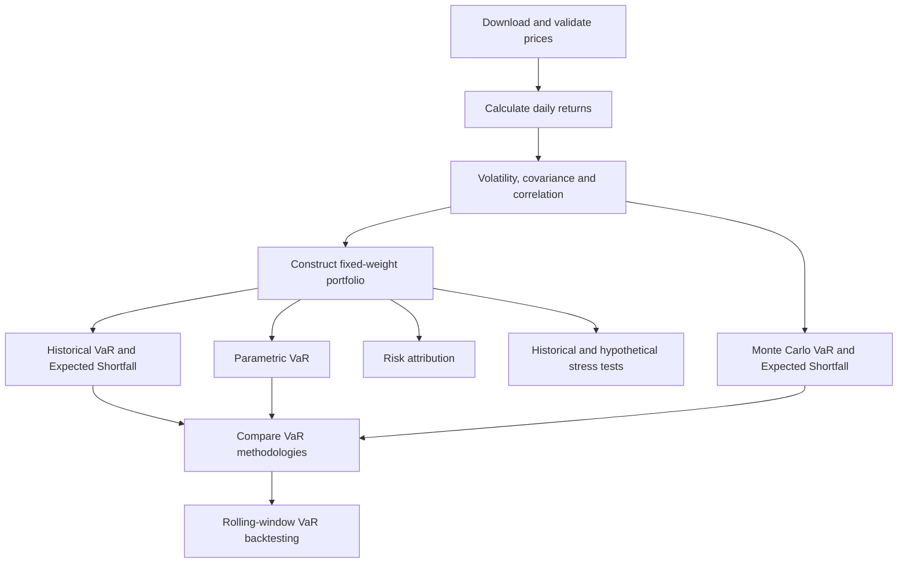
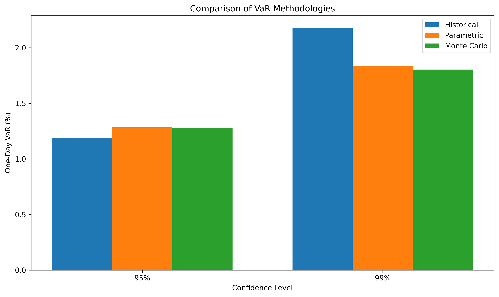
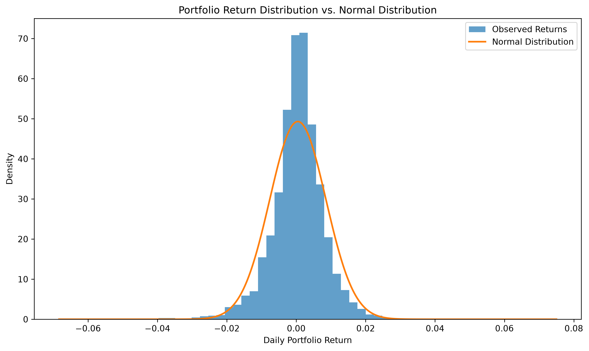
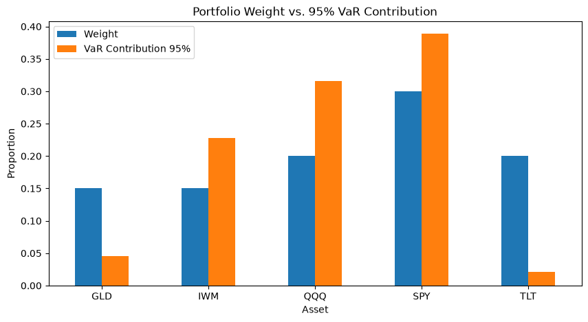
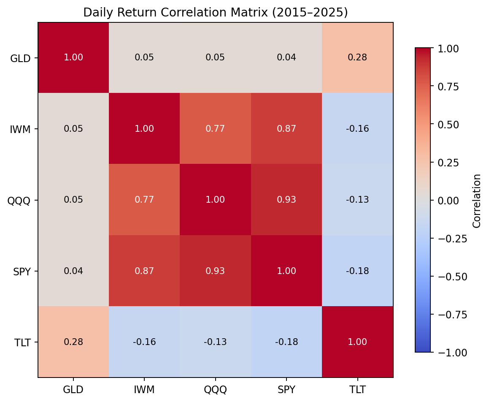
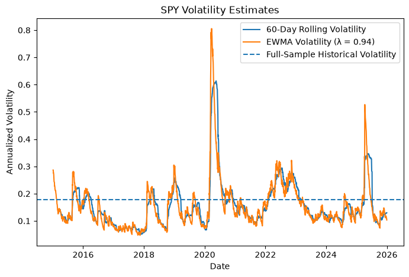
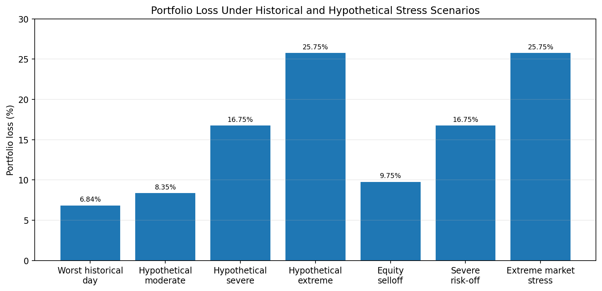
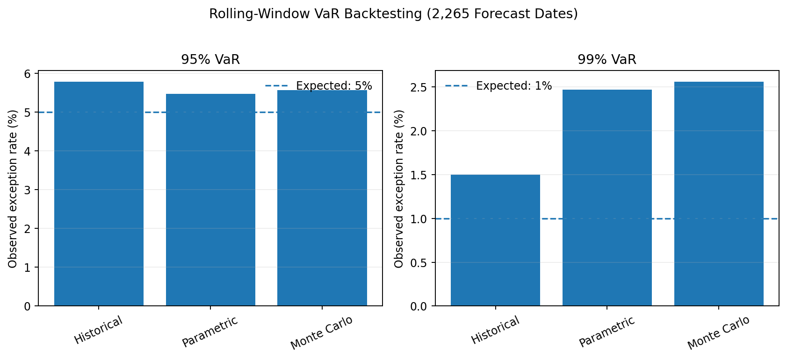

# Project 01 — Market Risk Engine

**A Python-based portfolio market-risk framework covering volatility estimation, correlation analysis, three Value at Risk (VaR) methodologies, Expected Shortfall, risk attribution, stress testing, and VaR backtesting.**

This project applies quantitative risk methods to a fixed-weight, multi-asset ETF portfolio using daily market data from **January 2015 through December 2025**. The notebooks are organized as an end-to-end workflow: from market data and return construction to portfolio loss estimation, risk decomposition, deterministic stress scenarios, and statistical backtesting.

> **Scope:** This is a research and portfolio project intended to demonstrate quantitative risk methods and model interpretation. It is not a production risk platform or investment recommendation.

## Contents

- [At a glance](#at-a-glance)
- [Portfolio and data](#portfolio-and-data)
- [Workflow](#workflow)
- [Key results](#key-results)
- [Risk attribution](#risk-attribution)
- [Stress testing](#stress-testing)
- [VaR backtesting and validation](#var-backtesting-and-validation)
- [Notebook guide](#notebook-guide)
- [Methodology and implementation details](#methodology-and-implementation-details)
- [Reproducing the analysis](#reproducing-the-analysis)
- [Limitations and future extensions](#limitations-and-future-extensions)

## At a glance

| Item | Implementation |
|---|---|
| Market data | Five ETFs; 2,766 daily price observations per asset in the downloaded sample |
| Return observations | 2,765 daily portfolio and asset return observations |
| Sample period | 2015-01-02 to 2025-12-31 in the downloaded data |
| Portfolio | Fixed weights across U.S. equities, long-duration U.S. Treasuries, and gold |
| Volatility | Full-sample historical, 60-trading-day rolling, and EWMA volatility |
| VaR methods | Historical simulation, normal Parametric VaR, and Monte Carlo VaR |
| Tail-risk measures | Historical and Monte Carlo Expected Shortfall |
| Risk decomposition | Marginal VaR, Component VaR, and percentage VaR contribution; volatility contribution analysis |
| Stress testing | Historical adverse days, hypothetical scenarios, single-factor shocks, and multi-factor scenarios |
| Backtesting | 500-observation rolling lookback; 95% and 99% VaR; Kupiec Proportion of Failures test |

## Portfolio and data

### Portfolio definition

The same portfolio weights are used throughout the notebooks so the risk measures can be compared on a consistent basis.

| Ticker | Weight | Exposure represented |
|---|---:|---|
| `SPY` | 30% | U.S. large-cap equities |
| `QQQ` | 20% | U.S. technology/growth equities |
| `IWM` | 15% | U.S. small-cap equities |
| `TLT` | 20% | Long-duration U.S. Treasury bonds |
| `GLD` | 15% | Gold |
| **Total** | **100%** | |

The portfolio combines assets with different volatility and dependence characteristics. The equity ETFs are strongly correlated with one another, while TLT and GLD show different return relationships in the sample. The portfolio is deliberately simple enough to make the risk calculations auditable while still illustrating diversification and concentration effects.

### Market data and quality checks

The notebooks use the project's `download_prices` helper to retrieve daily price history for the five tickers from the date range `2015-01-01` to `2026-01-01` (the last observed date in the downloaded sample is `2025-12-31`). Daily returns are calculated as percentage changes in price, and rows without a calculated return are dropped.

The data-preparation notebook checks date ordering, duplicate observations and columns, missing values, non-positive prices, and extreme returns. Its recorded results show:

- 2,766 dated price observations for each of the five assets.
- No duplicate dates or duplicate columns.
- Chronologically ordered observations.
- No missing or non-positive price observations in the downloaded sample.
- Large historical moves are inspected rather than automatically deleted, because actual market shocks are relevant to risk estimation.

The return-distribution analysis also calculates distributional statistics and performs Jarque–Bera normality tests. The notebook reports rejection of the normality null for all five assets, motivating comparison of empirical and normal-based tail-risk estimates.

## Workflow



## Key results

All VaR and Expected Shortfall (ES) values below are **one-day loss magnitudes as a percentage of portfolio value**. The positive VaR figures are the conventional loss-threshold representation; the corresponding return quantiles are negative. The figures reproduce the outputs recorded in the uploaded notebooks and can change if market data or implementation details change on a future run.

### Portfolio-level risk measures

| Measure | 95% confidence | 99% confidence |
|---|---:|---:|
| Historical VaR | 1.1848% | 2.1801% |
| Parametric VaR | 1.2844% | 1.8357% |
| Monte Carlo VaR | 1.2814% | 1.8040% |
| Historical Expected Shortfall | 1.9102% | 3.2484% |
| Monte Carlo Expected Shortfall | 1.6072% | 2.0829% |

Additional portfolio statistics:

| Metric | Result |
|---|---:|
| Mean daily portfolio return | 0.0463% |
| Daily portfolio volatility | 0.8090% |
| Annualized portfolio volatility (252 trading days) | **12.8423%** |
| Weighted average of constituent annualized volatilities | 18.33% |
| Historical portfolio-return minimum in sample | -6.8361% |
| Historical portfolio-return maximum in sample | 7.4988% |

The portfolio's calculated annualized volatility is lower than the weighted average of the individual asset volatilities, reflecting the effect of imperfect correlations. The covariance-matrix calculation and the standard deviation of the calculated portfolio-return series agree to the displayed precision.

### Visual comparison of the VaR estimates

<p align="center">
  
</p>

The three methods give similar estimates at the 95% level. At the 99% level, Historical VaR is materially higher than the normal-based Parametric and Monte Carlo estimates. This is consistent with the heavier empirical tails observed in the return data. In the current implementation, Monte Carlo VaR uses correlated normally distributed shocks, so it does not eliminate the normal-tail assumption simply by using simulation.

### Example in dollar terms

For an illustrative portfolio value of **$100,000**, the percentage estimates translate into the following one-day amounts:

| Measure | 95% loss threshold | 99% loss threshold |
|---|---:|---:|
| Historical VaR | $1,184.76 | $2,180.13 |
| Parametric VaR | $1,284.36 | $1,835.68 |
| Monte Carlo VaR | $1,281.39 | $1,804.03 |
| Historical Expected Shortfall | $1,910.24 | $3,248.43 |
| Monte Carlo Expected Shortfall | $1,607.18 | $2,082.93 |

VaR is a threshold at a specified confidence level, not a maximum possible loss. ES describes the average loss in the tail beyond the corresponding VaR threshold, which is why the reported ES values exceed VaR at each confidence level.

### Portfolio return distribution

<p align="center">
  
</p>

The chart compares the empirical portfolio-return distribution with the normal distribution used by the Parametric VaR model. The 95% and 99% thresholds are also marked. The divergence between the empirical lower tail and the fitted normal curve matters most when evaluating more extreme losses.

## Risk attribution

The project decomposes portfolio risk in two related ways: contribution to portfolio volatility in the portfolio-construction notebook, and contribution to Parametric VaR in the risk-attribution notebook. These measures answer different questions and should not be treated as interchangeable.

### Capital weight versus 95% VaR contribution

| Asset | Portfolio weight | Contribution to portfolio volatility | Contribution to 95% Parametric VaR |
|---|---:|---:|---:|
| GLD | 15% | 4.94% | 4.57% |
| IWM | 15% | 22.55% | 22.82% |
| QQQ | 20% | 31.19% | 31.60% |
| SPY | 30% | 38.56% | 38.87% |
| TLT | 20% | 2.76% | 2.14% |

<p align="center">
  
</p>

SPY, QQQ, and IWM contribute a greater share of VaR than their capital weights alone might suggest. For example, QQQ represents 20% of the portfolio but contributes about 31.6% of 95% Parametric VaR. TLT represents 20% of capital but contributes about 2.1% of 95% VaR in this calculation. This highlights why capital allocation is not a sufficient proxy for risk allocation.

The Component VaR decomposition is internally consistent: the sum of asset-level Component VaR equals the total Parametric VaR at both confidence levels, with a recorded difference of zero to the displayed precision.

### Dependence and diversification

<p align="center">
  
</p>

Selected historical correlations from the notebook:

- `SPY`–`QQQ`: **0.9338**
- `SPY`–`IWM`: **0.8672**
- `QQQ`–`IWM`: **0.7692**
- `TLT` correlations with the equity ETFs: approximately **-0.13 to -0.18**
- `GLD` correlations with `SPY` and `QQQ`: approximately **0.04 to 0.05**

These results show strong shared equity exposure in the three equity ETFs. Adding multiple equity funds therefore does not provide the same diversification as adding exposures with different return behavior.

### Volatility estimation

The volatility notebook compares full-sample historical volatility, a 60-trading-day rolling estimate, and Exponentially Weighted Moving Average (EWMA) volatility. Annualized volatility is calculated using the conventional factor of $\sqrt{252}$. The EWMA implementation uses a decay factor of $\lambda = 0.94$, giving greater weight to recent squared returns.

<p align="center">
  
</p>

The full-sample estimate is constant by construction. Rolling volatility responds to changes within the recent 60-day window, while EWMA responds to recent return shocks through exponential weighting. In the current project, these methods are compared diagnostically; the VaR methodologies summarized above use the historical sample mean/covariance and normal-distribution assumptions rather than an EWMA/GARCH volatility forecast.

## Stress testing

Stress testing complements VaR by asking how the portfolio would respond to specified adverse moves. It does not attach a probability to a scenario.

### Selected portfolio-loss scenarios

| Scenario | Portfolio loss |
|---|---:|
| Worst historical daily loss in the sample (2020-03-12) | 6.8361% |
| Hypothetical — Moderate | 8.35% |
| Multi-factor — Equity Selloff | 9.75% |
| Hypothetical — Severe | 16.75% |
| Multi-factor — Severe Risk-Off | 16.75% |
| Hypothetical — Extreme | 25.75% |
| Multi-factor — Extreme Market Stress | 25.75% |

<p align="center">
  
</p>

The hypothetical scenarios apply predefined shocks to SPY, QQQ, IWM, TLT, and GLD, then calculate the portfolio return as the weighted sum of those shocks. The notebook also isolates single-asset shocks from 5% to 30% and reports asset-level contributions under the multi-factor scenarios. These are deterministic sensitivities rather than forecasts or calibrated probabilities.

## VaR backtesting and validation

The backtesting notebook compares rolling one-day VaR forecasts with realized portfolio losses. Each forecast uses a **500-observation lookback window** and is evaluated at 95% and 99% confidence. The evaluation covers **2,265 forecast dates**, from 2016-12-28 through 2025-12-31. For the Monte Carlo forecast inside the backtest, the notebook generates 10,000 scenarios per forecast using a fixed random seed.

A VaR exception occurs when the realized loss exceeds the forecast VaR. The notebook compares the observed exception rate with the expected tail probability and applies the **Kupiec Proportion of Failures (POF) test** at the 5% significance level.

| Model | 95% exceptions | Observed rate | Kupiec POF p-value | 99% exceptions | Observed rate | Kupiec POF p-value |
|---|---:|---:|---:|---:|---:|---:|
| Historical VaR | 131 | 5.78% | 0.0946 | 34 | 1.50% | 0.0257 |
| Parametric VaR | 124 | 5.47% | 0.3070 | 56 | 2.47% | 3.01 × 10⁻⁹ |
| Monte Carlo VaR | 126 | 5.56% | 0.2269 | 58 | 2.56% | 4.39 × 10⁻¹⁰ |
| Expected exception rate | — | **5.00%** | — | — | **1.00%** | — |

<p align="center">
  
</p>

**Interpretation:** At the 5% significance level, the Kupiec test does not reject any of the three models at 95% confidence. At 99% confidence, it rejects all three models. The observed exception rates are materially higher than the expected 1% for the Parametric and Monte Carlo models, and the Historical VaR model is also rejected by the test. This suggests that the models, as implemented, do not adequately match the frequency of extreme losses at the 99% level over this backtest period.

The POF test checks exception frequency only. It does not test whether exceptions are independent or arrive in clusters, and failure to reject a null hypothesis at 95% is not proof that a model is correctly specified.

## Notebook guide

Run the notebooks in numerical order. Each notebook develops one stage of the analysis and uses the same asset universe and portfolio weights.

| Notebook | Purpose and main outputs |
|---|---|
| `01_market_data_and_returns.ipynb` | Download and inspect market prices, test data quality, calculate daily returns, examine empirical distributions, and run Jarque–Bera normality tests. |
| `02_volatility_and_correlation.ipynb` | Estimate historical and 60-day rolling volatility, covariance and correlation matrices, and compare rolling volatility with EWMA volatility ($\lambda=0.94$). |
| `03_portfolio_construction.ipynb` | Define fixed portfolio weights, construct portfolio returns, calculate annualized volatility, and decompose portfolio volatility by asset. |
| `04_historical_var.ipynb` | Estimate empirical 95% and 99% VaR and Historical Expected Shortfall; translate the risk estimates to a hypothetical $100,000 portfolio. |
| `05_parametric_var.ipynb` | Estimate normal-based Parametric VaR, compare fitted-normal thresholds with empirical returns, and quantify the difference from Historical VaR. |
| `06_monte_carlo_var.ipynb` | Generate 100,000 correlated normal return scenarios, estimate Monte Carlo VaR and ES, and compare the three VaR methods. |
| `07_risk_attribution.ipynb` | Calculate Marginal VaR, Component VaR, percentage VaR contributions, and verify the Euler decomposition. |
| `08_stress_testing.ipynb` | Review severe historical losses; test hypothetical moderate, severe, and extreme scenarios; calculate single-factor and multi-factor sensitivities. |
| `09_var_backtesting.ipynb` | Create 500-observation rolling VaR forecasts, calculate exception rates, compare them with expected rates, and apply the Kupiec POF test. |

> The names above describe the notebooks' logical sequence. If the files in a checkout include suffixes such as `(4)` or are stored in a nested notebook directory, use the actual local filenames and preserve the execution order.

## Methodology and implementation details

### Portfolio returns and volatility

For asset weights $w_i$ and daily asset returns $r_{i,t}$, the portfolio return is calculated as:

$$
r_{p,t} = \sum_{i=1}^{n} w_i r_{i,t}
$$

The weights sum to 100% and are held constant for the analysis. Portfolio volatility is calculated from the portfolio return series and cross-checked against the covariance-matrix expression:

$$
\sigma_p = \sqrt{w^T \Sigma w}
$$

where $\Sigma$ is the return covariance matrix. Annualized volatility is daily volatility multiplied by $\sqrt{252}$.

### Historical VaR

Historical VaR uses the observed return distribution without fitting a theoretical distribution. At confidence level $c$, the lower-tail empirical return quantile at probability $1-c$ is multiplied by -1 to report VaR as a positive loss magnitude.

### Parametric VaR

Parametric VaR assumes normally distributed portfolio returns and uses the estimated daily mean and volatility:

$$
\operatorname{VaR}_c = -\left(\mu_p + z_{1-c}\sigma_p\right)
$$

where $z_{1-c}$ is the standard-normal lower-tail quantile. This method is straightforward and interpretable, but its tail estimates depend on the normality assumption.

### Monte Carlo VaR and Expected Shortfall

The principal Monte Carlo notebook estimates the historical asset-return mean vector and covariance matrix, generates **100,000** correlated multivariate-normal scenarios using a Cholesky decomposition, converts simulated asset returns into portfolio returns, and obtains VaR from the simulated lower tail. Monte Carlo ES averages simulated losses beyond the corresponding VaR threshold. Because shocks are normal in this implementation, Monte Carlo VaR is not a fat-tailed model; changing the simulation framework to alternative distributions is a potential extension.

### Risk attribution

Marginal VaR estimates sensitivity of portfolio VaR to an incremental change in an asset weight. Component VaR multiplies Marginal VaR by the asset weight. Percentage VaR contribution divides each asset's Component VaR by total portfolio VaR. The implementation verifies that Component VaR contributions sum to total VaR at both 95% and 99% confidence, consistent with the Euler decomposition used in the notebook.

### Stress testing

Historical stress testing reuses asset returns from the largest realized portfolio-loss days. Hypothetical and multi-factor stress tests apply explicit asset-level shocks and aggregate them using the portfolio weights. Single-factor sensitivity holds all other asset returns at zero to isolate one position's direct effect.

### Backtesting

For each evaluation date, the notebook estimates the three VaR measures from the immediately preceding 500 observations and checks whether the next realized loss exceeds each threshold. The Kupiec POF test evaluates whether the observed exception count is consistent with the expected tail probability under the stated VaR confidence level.

## Reproducing the analysis

### 1. Set up a Python environment

This project is one of four projects in the larger **Risk Portfolio** repository. The shared `requirements.txt` file lives in the repository's main folder, one level above this project's folder. Use that file as the source of truth for dependencies so the README does not duplicate or drift from the repository's environment specification.

Run the following commands from this Project 01 folder:

```bash
python -m venv .venv
```

Activate the environment:

```bash
# macOS / Linux
source .venv/bin/activate

# Windows PowerShell
.venv\Scripts\Activate.ps1
```

Install dependencies from the shared requirements file in the parent directory:

```bash
python -m pip install --upgrade pip
python -m pip install -r ../requirements.txt
```

> The relative path `../requirements.txt` assumes this project folder is directly inside the `Risk Portfolio` repository root. If you move the project to a different location or change the folder structure, update the path accordingly.

### 2. Open the project in Jupyter

Launch Jupyter from this Project 01 folder so the notebooks' relative paths resolve as expected:

```bash
jupyter lab
```

Open the notebooks in the order listed in the [notebook guide](#notebook-guide). They import project helper functions from `project_01_market_risk_engine.src.data` and `project_01_market_risk_engine.src.var`; preserve the package directory and the working-directory assumptions used in the notebook path setup. The market-data cells download price history, so a fresh run requires network access and may produce slightly different values if the data provider revises historical data.

### 3. Review the outputs

The tables and figures embedded in each notebook are the detailed record of the calculations. The figures linked in this README are provided under `results/figures/` so they render directly when this README and its figure directory are placed at the project root.

## Limitations and future extensions

The current implementation is a useful methodology comparison, but it has important limitations:

- **Normality assumptions:** Parametric VaR and the current Monte Carlo simulation use normal-based tail estimates. The empirical returns fail the Jarque–Bera normality tests, and the backtest rejects all three models at 99% confidence.
- **Static portfolio:** The analysis uses fixed weights and does not model changes in holdings, transaction costs, financing, or portfolio rebalancing costs.
- **Historical dependence:** Historical VaR depends on the selected sample. The mean vector and covariance matrix used by the normal-based methods may not adapt well to structural breaks or changing market regimes.
- **Volatility dynamics:** Rolling and EWMA volatility are examined, but volatility forecasts are not yet fully integrated into a dynamic VaR forecasting model. GARCH or filtered historical simulation could be added for this purpose.
- **Stress-scenario design:** Hypothetical scenarios are hand-specified sensitivities, not probability-calibrated forecasts. The scenarios do not incorporate liquidity haircuts or transaction-cost effects.
- **Backtesting coverage:** Kupiec POF tests exception frequency, but the workflow does not yet test exception independence/clustering or apply conditional-coverage tests. Results also depend on the chosen 500-observation lookback and the evaluation period.
- **Production controls:** The project does not yet include a full automated test suite, model governance documentation, independent benchmark sign-off, or production monitoring.

Potential next extensions include conditional-coverage backtests, alternative innovation distributions (such as Student-t), filtered historical simulation, integrating EWMA/GARCH forecasts into VaR, additional calibrated historical and hypothetical stress scenarios, and automated tests for the risk-measure functions.

---

**Project takeaway:** The central finding is that the reported risk level depends on the chosen methodology. The three VaR estimates are close at 95% confidence but diverge in the 99% tail, while rolling-window backtesting highlights material underestimation of extreme-loss frequency at 99%. Risk attribution and stress testing provide complementary views of concentration and vulnerability that VaR alone cannot supply.
