# Project 02 — Black-Scholes, Greeks & Derivatives Risk Engine

**A Python-based derivatives pricing and risk-analysis project that connects observed SPY option-market data with Black-Scholes pricing, option Greeks, implied-volatility estimation, and portfolio stress testing.**

The project builds an end-to-end workflow: retrieve and validate an option chain, compare theoretical and observed prices, calculate sensitivities, invert market prices to estimate implied volatility, and evaluate an illustrative options portfolio under market shocks.

> **Scope:** This is an educational quantitative-risk and model-analysis project. The portfolio and stress scenarios are illustrative, the market-data snapshot changes over time, and the implementation is not a production pricing or trading system.

## Contents

- [At a glance](#at-a-glance)
- [Market data and option universe](#market-data-and-option-universe)
- [Workflow](#workflow)
- [Key results](#key-results)
- [Black-Scholes pricing](#black-scholes-pricing)
- [Option Greeks and sensitivity analysis](#option-greeks-and-sensitivity-analysis)
- [Implied volatility and volatility skew](#implied-volatility-and-volatility-skew)
- [Portfolio construction and risk](#portfolio-construction-and-risk)
- [Stress testing and full revaluation](#stress-testing-and-full-revaluation)
- [Notebook guide](#notebook-guide)
- [Core equations](#core-equations)
- [Limitations and future extensions](#limitations-and-future-extensions)

## At a glance

| Item | Implementation |
|---|---|
| Underlying | SPDR S&P 500 ETF Trust (`SPY`) |
| Data source | Option-chain and underlying-price data retrieved with `yfinance` |
| Market-data output | 256 cleaned contracts: 129 calls and 127 puts |
| Selected expiration in saved outputs | 20 November 2026; 44 days to expiry in the saved snapshot |
| Market variables | Bid, ask, midpoint, last price, volume, open interest, provider implied volatility, intrinsic value, time value, and moneyness |
| Pricing model | Black-Scholes for European calls and puts |
| Baseline model assumptions | 4.0% risk-free rate, 1.2% dividend yield, and 20.0% annualized volatility for the fixed-volatility pricing comparison |
| Risk sensitivities | Delta, Gamma, Vega, Theta, and Rho |
| Implied volatility | Numerical inversion of Black-Scholes using Brent's root-finding method |
| Portfolio analysis | Six illustrative long/short SPY option positions, using a 100-share contract multiplier |
| Stress testing | Underlying-price shocks, volatility shocks, time-decay scenarios, combined shocks, and full Black-Scholes revaluation |

The spot price in the saved notebook outputs is approximately **$774.89**. These figures describe the saved notebook snapshot, not a live quote. Re-running the first notebook retrieves fresh market data, so prices, expiration selection, model errors, and stress results can change.

## Market data and option universe

### Data collection and preparation

Notebook 01 retrieves SPY option-chain data through `yfinance`. It selects the expiration nearest a target of 45 calendar days, retrieves calls and puts for that expiration, and combines them into a common contract table.

The cleaned dataset contains **256 contracts** across calls and puts and is used by the downstream notebooks. The saved snapshot contains 129 calls and 127 puts. The data-preparation notebook derives the following fields:

- **Mid-price:** the midpoint of the displayed bid and ask, used as the primary market-price estimate.
- **Time to maturity:** calendar days to expiration divided by 365.
- **Moneyness:** strike price divided by the underlying spot price, $K/S$.
- **Intrinsic value:** $\max(S-K,0)$ for calls and $\max(K-S,0)$ for puts.
- **Time value:** market midpoint minus intrinsic value.
- **Option type and expiration:** normalized fields used consistently throughout the project.

The notebook includes assertion-based checks for positive bids and midpoint prices, asks greater than or equal to bids, positive time to expiry, and valid call/put labels. It also reviews missing values, liquidity fields, and the distribution of option prices and provider-reported implied volatility.

### Option prices across strike

  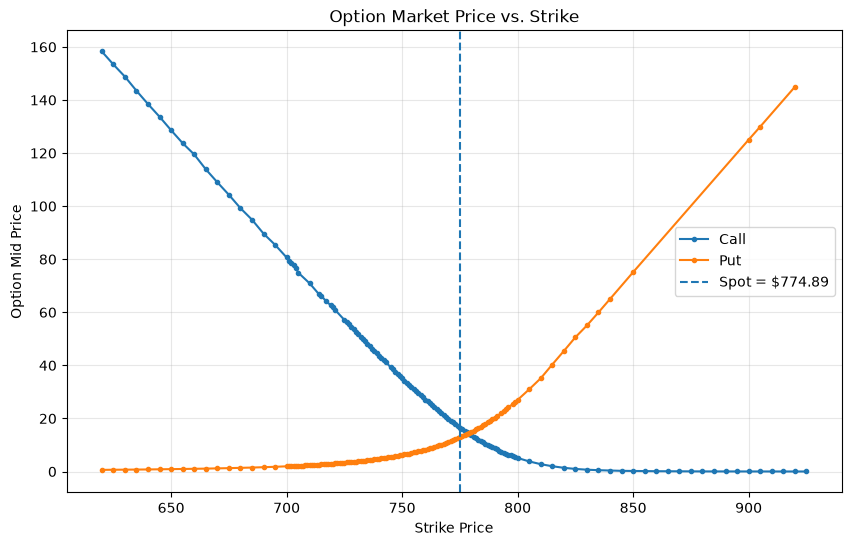

For a fixed expiration, call prices generally fall as strike rises, while put prices generally rise. The observed curves provide the market reference for the Black-Scholes comparisons that follow.

### Market-reported implied volatility and option payoffs

  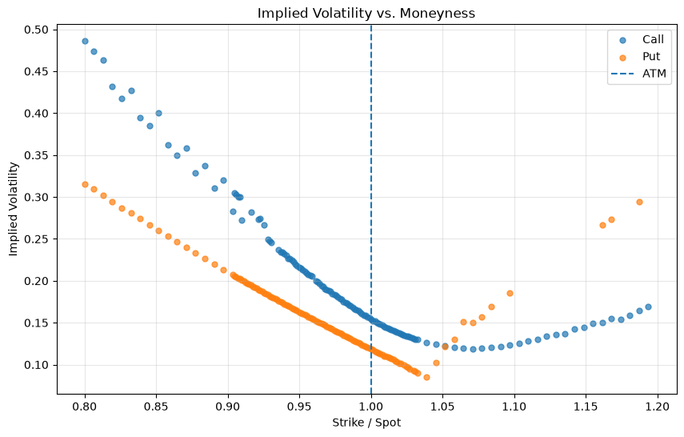

The provider-reported implied-volatility values vary across strikes. The plot is an initial diagnostic of the volatility structure in the downloaded chain; quote quality and liquidity should be considered before treating every point as reliable.

  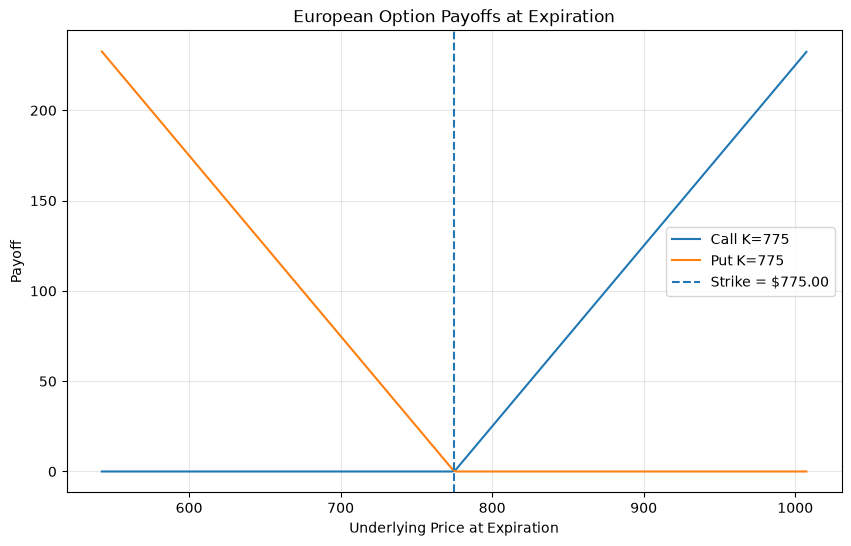

The payoff chart illustrates expiration payoff, not profit after premium. For a purchased option, profit also depends on the premium paid and any transaction costs.

## Workflow

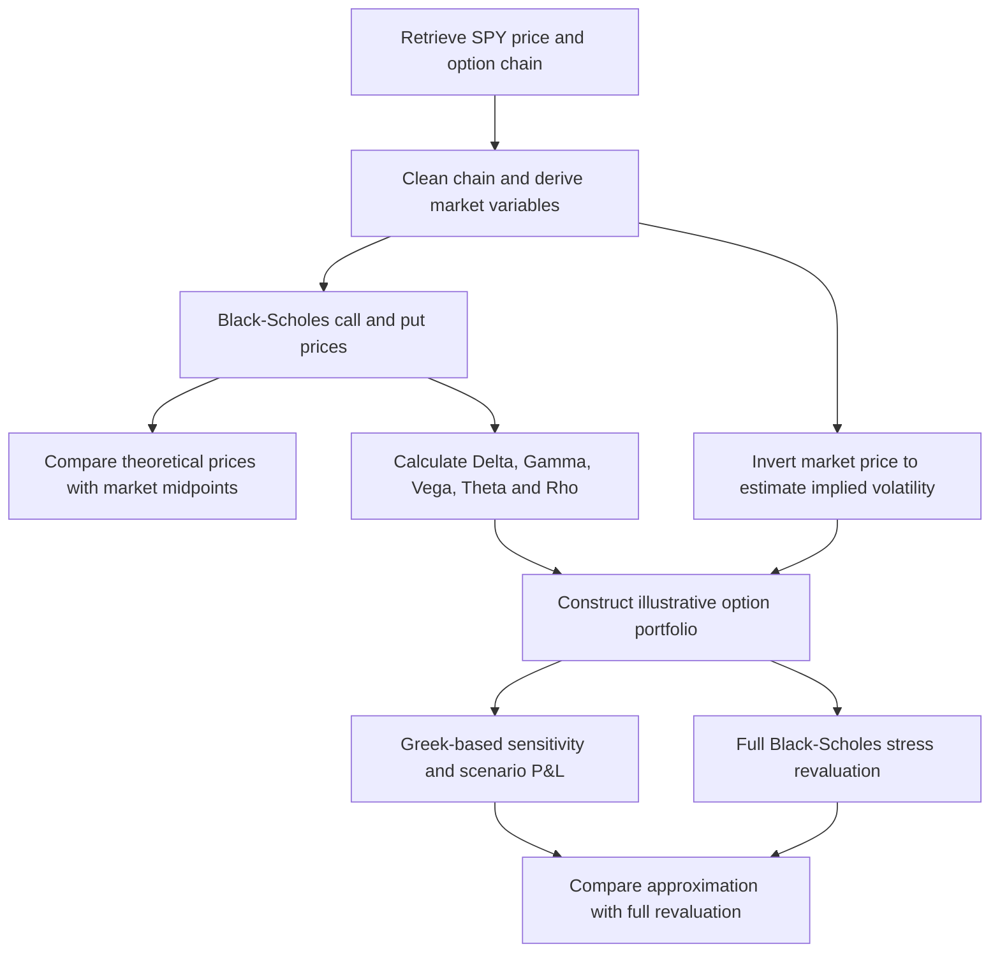

## Key results

The metrics below reproduce the saved notebook outputs. Option premiums and pricing errors are quoted per option share unless otherwise stated. The results are not a guarantee of performance or a statement about current market conditions.

### Market data and pricing diagnostics

| Metric | Recorded result |
|---|---:|
| SPY spot in saved output | $774.8863 |
| Selected option expiration | 2026-11-20 |
| Days to expiration in saved output | 44 |
| Cleaned option contracts | 256 |
| Calls / puts | 129 / 127 |
| Risk-free rate for fixed-volatility comparison | 4.0% |
| Dividend yield | 1.2% |
| Fixed volatility used in baseline Black-Scholes comparison | 20.0% |

The Black-Scholes pricing comparison calculates `pricing_error = bs_price - mid_price` over all 256 contracts:

| Pricing-error statistic | Result |
|---|---:|
| Mean | +$2.7608 |
| Median | +$2.2779 |
| Standard deviation | $3.2974 |
| Minimum | -$2.9736 |
| Maximum | +$8.1714 |

The positive mean indicates that, under the notebook's fixed 20% volatility and other baseline inputs, theoretical prices average above market midpoints in this sample. The variation across contracts also shows why a single fixed volatility is not sufficient to explain the entire option chain. These are uncalibrated baseline comparisons, not a claim that the model has been independently validated.

### Implied-volatility solver diagnostics

| Metric | Recorded result |
|---|---:|
| Contracts attempted | 256 |
| Successful implied-volatility calculations | 147 (57.4%) |
| Failed implied-volatility calculations | 109 (42.6%) |
| Contracts compared with provider IV | 147 |
| Mean calculated-minus-provider IV difference | +0.084630 |
| Mean absolute IV difference | 0.233672 |
| Maximum absolute IV difference | 1.263337 |

Volatility values and differences are represented as decimals in the notebook, so an absolute difference of 0.233672 corresponds to about 23.37 volatility percentage points. The failed calculations and sizeable differences are material diagnostics: the calculated volatility plot should not be treated as a fully validated volatility surface. The notebook itself notes that the valid put sample is insufficient to establish a robust estimate of the complete SPY volatility skew.

## Black-Scholes pricing

The project implements the Black-Scholes equations for European-style call and put options with continuous dividend yield. The baseline comparison applies the same 4.0% risk-free rate, 1.2% dividend yield, and 20.0% volatility assumption to every contract.

### Model prices versus market prices

  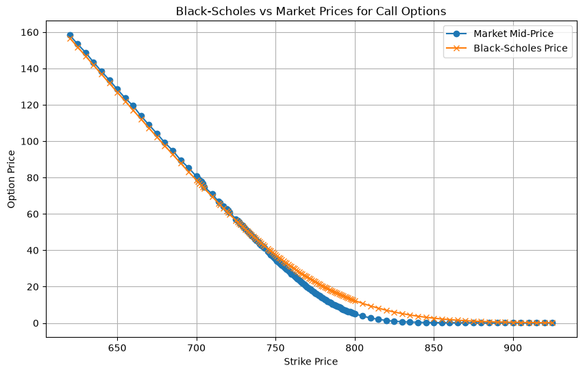

  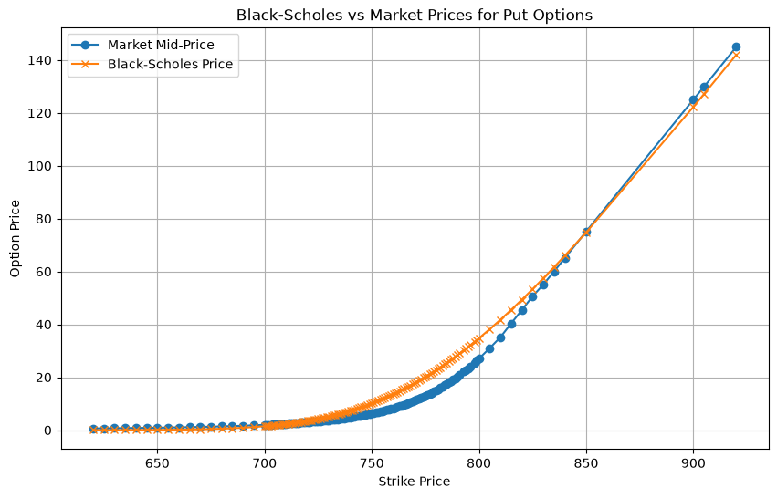

The model-versus-market comparison isolates the effect of using one volatility assumption across strikes. Market midpoint prices embed the market's strike-dependent pricing and liquidity conditions, while the baseline model uses a constant volatility. Differences should therefore be interpreted alongside the subsequent implied-volatility results, not as pure model error alone.

## Option Greeks and sensitivity analysis

The project calculates the five primary Black-Scholes Greeks and applies them across the option chain. The notebook also varies the underlying price, volatility, and time to maturity to illustrate how the theoretical price of a representative near-the-money call responds to changes in its inputs.

| Greek | Risk interpretation |
|---|---|
| **Delta** | First-order sensitivity to a change in underlying price |
| **Gamma** | Sensitivity of Delta to underlying price; captures second-order price curvature |
| **Vega** | Sensitivity to volatility; the implementation reports sensitivity to a 1.00 change in volatility, so a 1 percentage-point move is approximately Vega × 0.01 |
| **Theta** | Sensitivity to the passage of time; the formula is expressed on a per-year basis |
| **Rho** | Sensitivity to the risk-free interest rate |

### Delta and Gamma profiles

  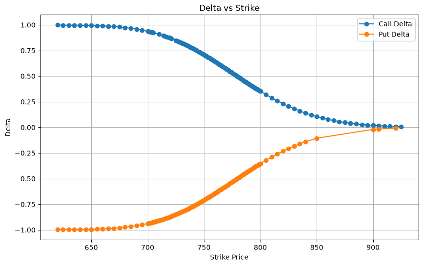

Call Delta trends from near 1 for deeply in-the-money contracts toward 0 for out-of-the-money contracts. Put Delta trends from near -1 toward 0. Delta therefore changes substantially with strike and moneyness.

  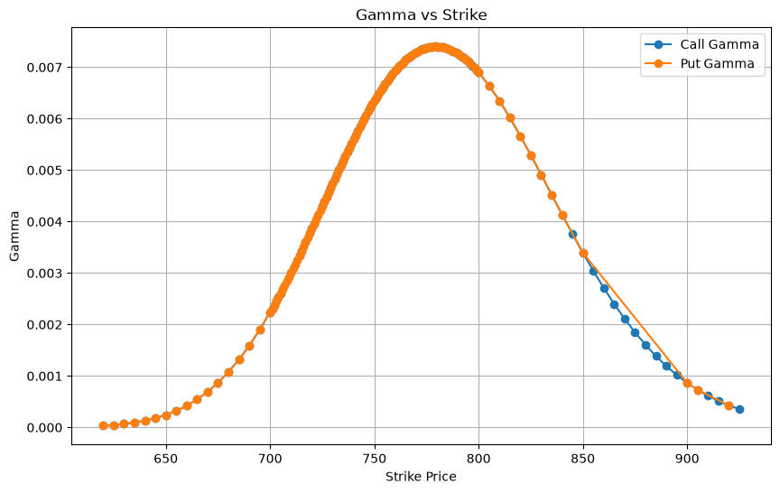

Gamma is concentrated around the near-the-money region in the saved chart and declines for many contracts further from the strike region around spot. This is why a portfolio's Delta can change materially under a large underlying-price move.

The notebook also includes Vega, Theta, and Rho profiles across strike, along with sensitivity plots for call value versus underlying price, volatility, and time to maturity. Those additional plots are available in the notebook outputs and are regenerated when the analysis is rerun.

## Implied volatility and volatility skew

Implied volatility is estimated by numerically solving the inverse Black-Scholes problem: find the volatility that makes the theoretical option price equal to the observed midpoint price. The notebook uses **Brent's root-finding method** and compares calculated IVs with Yahoo Finance's reported values.

  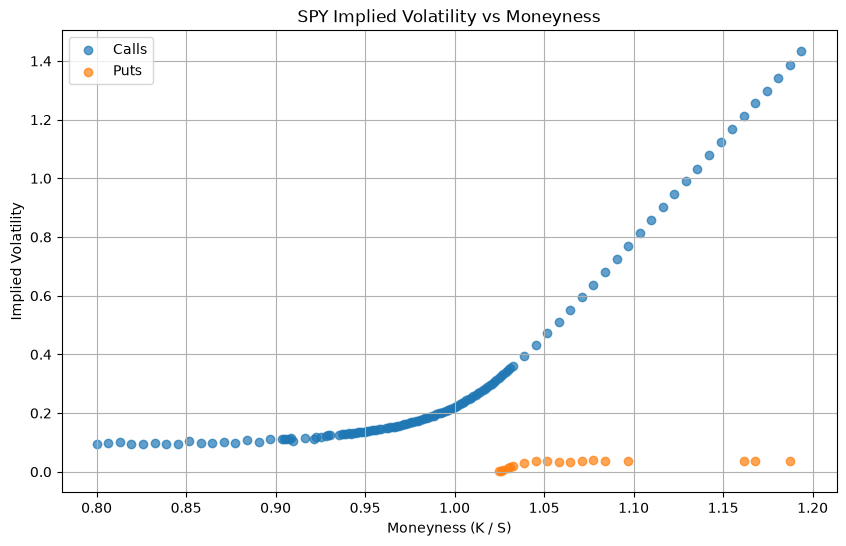

The calculated IV observations are uneven, with extreme values at parts of the strike range. The saved output contains only 18 valid put IV observations alongside 129 valid call observations, so it does not provide a robust basis for estimating the full put-side skew. This is a useful model-risk result: numerical convergence, quote quality, and stability across moneyness need to be checked before an implied-volatility surface is used downstream.

## Portfolio construction and risk

Notebook 05 constructs an illustrative six-position portfolio using the selected SPY expiration and market midpoint prices. Signed quantities represent long and short positions. Each option position is scaled by a standard **100-share contract multiplier**.

### Position definitions

| Option type | Strike | Signed quantity | Saved midpoint price |
|---|---:|---:|---:|
| Call | $750 | +10 | $35.095 |
| Call | $800 | -10 | $5.110 |
| Put | $750 | +10 | $6.260 |
| Put | $800 | -10 | $27.000 |
| Call | $775 | +10 | $16.580 |
| Put | $775 | +10 | $12.865 |

The saved portfolio market value is **$38,690.00**. It is calculated by aggregating signed position quantities, market midpoint prices, and the contract multiplier. It is the mark-to-market value of this constructed example, not capital at risk or a recommended trade.

### Aggregate portfolio Greek exposures

The following are the aggregate exposures recorded by the notebook after applying signed quantities and the contract multiplier. Units and scaling follow the implementations used for the respective Greeks, so the values should be interpreted together with the model formulas rather than compared numerically across Greek types.

| Greek exposure | Recorded value |
|---|---:|
| Delta | -41.8664 |
| Gamma | +16.3402 |
| Vega | +216,024.8845 |
| Theta | -174,554.1903 |
| Rho | +93,376.7501 |

The portfolio has relatively small negative Delta but positive Gamma and Vega, alongside negative Theta. This means first-order directional exposure alone does not describe the portfolio's complete risk profile: its sensitivity changes with the underlying price, implied volatility, and time remaining to expiration.

## Stress testing and full revaluation

The stress-testing notebook assesses the portfolio under a deterministic grid of shocks. It uses underlying price shocks of **-10%, -5%, -2%, 0%, +2%, +5%, and +10%**, and implied-volatility shocks of **-5, -2, 0, +2, and +5 percentage points**. It also evaluates time decay over 1, 5, 10, and 20 days.

Two approaches are compared:

1. **Greek-based approximation:** estimates P&L using Delta and Gamma for underlying-price moves, plus Vega for volatility moves.
2. **Full Black-Scholes revaluation:** reprices the portfolio's option positions under each stressed underlying price and volatility input, then compares the revalued portfolio with its current value.

### Full-revaluation scenario results

The saved 35-scenario grid reports the following extremes **within the specified grid**:

| Scenario | SPY price shock | Volatility shock | Portfolio P&L |
|---|---:|---:|---:|
| Lowest P&L in grid | -5% (SPY ≈ $736.14) | -5 percentage points | -$36,976.04 |
| Highest P&L in grid | +10% (SPY ≈ $852.37) | -5 percentage points | +$90,614.77 |

These are outputs from the portfolio definition and model assumptions in the notebook, not universal worst-case or best-case losses. Stress testing is deterministic and does not assign probabilities to the scenarios.

### Full revaluation versus Delta–Gamma approximation

  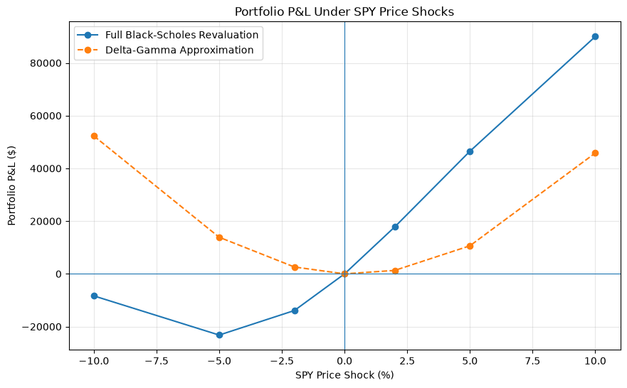

For the price-only comparison (no volatility shock), the notebook reports:

| Approximation error metric | Result |
|---|---:|
| Mean absolute error | $30,104.34 |
| Root mean squared error | $35,522.76 |

The large divergence is a central model-risk finding in this example. The Delta–Gamma approximation is local to the current valuation point and does not reproduce all nonlinear effects captured by full revaluation. It is particularly unreliable for the portfolio and stress range used here; the saved results show meaningful divergence even around ±2% SPY price shocks. These values should prompt further review of position-level sensitivities, volatility inputs, and scenario implementation before using the approximation for decision-making.

### Gamma and Vega stress contributions

  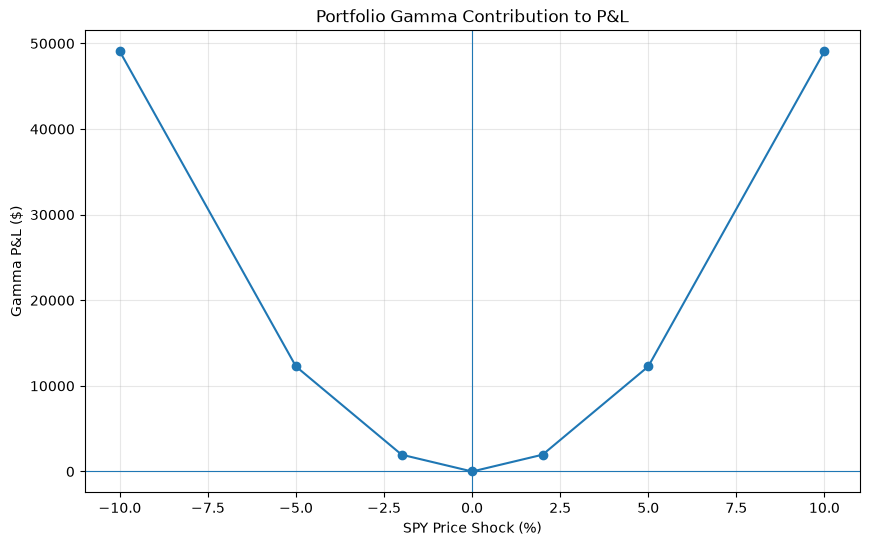

  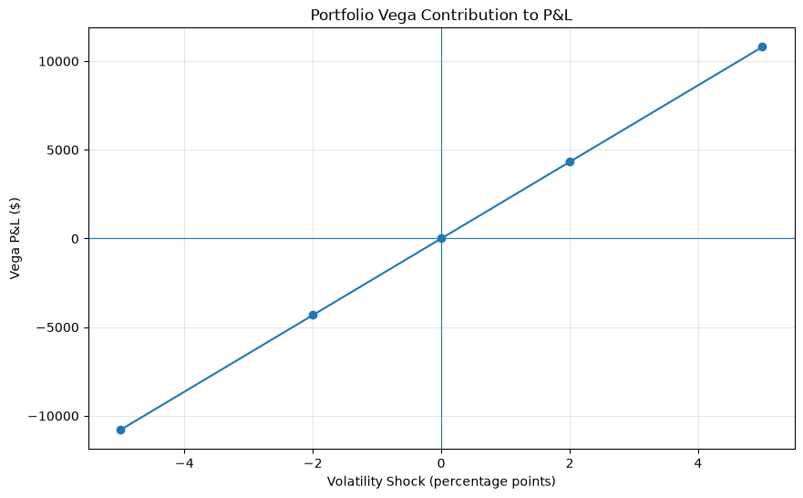

The Gamma contribution is quadratic in the underlying-price move under the second-order approximation. The Vega contribution is linear in the volatility shock. These are component sensitivities, not substitutes for the complete full-revaluation results.

## Notebook guide

Run the notebooks in numeric order so that the cleaned option-chain dataset is created before the pricing, Greeks, IV, and portfolio analyses.

| Notebook | Purpose | Main output |
|---|---|---|
| `01_options_and_market_data.ipynb` | Retrieve and validate the SPY option chain; derive mid-price, maturity, moneyness, intrinsic value, and time value; inspect price and IV patterns | Cleaned option-chain data and market-data plots |
| `02_black_scholes_pricing.ipynb` | Implement Black-Scholes call and put pricing; compare theoretical prices against observed midpoints; summarize pricing errors | Model prices and pricing-error statistics |
| `03_greeks_sensitivity_analysis.ipynb` | Calculate Delta, Gamma, Vega, Theta, and Rho; analyze Greek profiles and price sensitivity to spot, volatility, and maturity | Greek table and sensitivity plots |
| `04_implied_volatility_volatility_smile.ipynb` | Invert market option prices with Brent's method; compare calculated IV with provider IV; analyze smile/skew | Calculated IV estimates, solver diagnostics, and IV chart |
| `05_options_portfolio_risk_stress_testing.ipynb` | Define a long/short option portfolio; aggregate Greeks; run individual and combined stress scenarios; compare approximation with full revaluation | Portfolio exposures, scenario matrices, P&L curves, and approximation-error metrics |

## Core equations

### Black-Scholes pricing

For European-style options with continuous dividend yield $q$:

$$
d_1 = \frac{\ln(S/K) + (r-q+\frac{1}{2}\sigma^2)T}{\sigma\sqrt{T}}, \qquad
d_2 = d_1 - \sigma\sqrt{T}
$$

$$
C = S e^{-qT}N(d_1) - K e^{-rT}N(d_2)
$$

$$
P = K e^{-rT}N(-d_2) - S e^{-qT}N(-d_1)
$$

### Option Greeks

Let $N(\cdot)$ be the standard-normal cumulative distribution function and $N'(\cdot)$ its density.

$$
\Delta_{call}=e^{-qT}N(d_1), \qquad \Delta_{put}=e^{-qT}[N(d_1)-1]
$$

$$
\Gamma=\frac{e^{-qT}N'(d_1)}{S\sigma\sqrt{T}}, \qquad
Vega=S e^{-qT}N'(d_1)\sqrt{T}
$$

$$
\Theta_{call}=-\frac{S e^{-qT}N'(d_1)\sigma}{2\sqrt{T}}-rKe^{-rT}N(d_2)+qSe^{-qT}N(d_1)
$$

$$
\Theta_{put}=-\frac{S e^{-qT}N'(d_1)\sigma}{2\sqrt{T}}+rKe^{-rT}N(-d_2)-qSe^{-qT}N(-d_1)
$$

$$
Rho_{call}=KTe^{-rT}N(d_2), \qquad Rho_{put}=-KTe^{-rT}N(-d_2)
$$

The implementation reports Vega for a 1.00 change in volatility; a one-percentage-point volatility shock is approximately $Vega\times0.01$. Theta is expressed per year.

### Greek-based portfolio P&L approximation

$$
\Delta P\&L \approx \Delta_{portfolio}\Delta S + \frac{1}{2}\Gamma_{portfolio}(\Delta S)^2
$$

$$
\Delta P\&L \approx \Delta_{portfolio}\Delta S + \frac{1}{2}\Gamma_{portfolio}(\Delta S)^2 + Vega_{portfolio}\Delta\sigma
$$

## Limitations and future extensions

- **Market snapshot:** Option prices, spot prices, available expirations, liquidity, and provider IVs change continuously. Exact numerical results will vary when `yfinance` data are refreshed.
- **Fixed-volatility benchmark:** The baseline Black-Scholes comparison uses a constant 20% volatility. This is useful for demonstrating price differences but is not a market-calibrated valuation for every strike.
- **Implied-volatility convergence and quality:** 109 of 256 contracts did not yield a valid IV under the current implementation. The calculated-IV/provider-IV differences are material, and extreme values appear in the saved smile plot. Better filtering, solver diagnostics, quote-quality controls, and validation are needed before using an IV surface.
- **Limited put-side IV sample:** The notebook records only 18 valid put IV observations, insufficient to estimate the full downside skew robustly.
- **Model assumptions:** Black-Scholes assumes constant volatility and interest rates, continuous trading, a lognormal underlying-price process, no transaction costs, and European-style exercise. These assumptions do not fully represent real option markets; SPY options are American-style contracts, so early-exercise considerations are not modeled here.
- **Liquidity and execution:** Midpoints are used as market-price estimates. Bid-ask spread, market depth, transaction costs, slippage, and executable prices are not modeled.
- **Illustrative portfolio:** The six positions are constructed to study derivatives risk, not to represent an actual account or recommended strategy.
- **Approximation error:** The recorded Delta–Gamma approximation errors are very large relative to this example's portfolio value. Position-level Greeks, option-value conventions, IV inputs, and scenario implementation should be reviewed before relying on the approximation.
- **Deterministic scenarios:** The stress grid is illustrative and does not assign probabilities or cover every possible market event.

Potential next steps include adding stricter quote filters, validating implied volatility against independently sourced option prices, extending the volatility surface across expirations, incorporating bid-ask and liquidity effects, adding alternative pricing approaches, and building automated checks that compare Greek approximations with full repricing over a range of portfolio configurations.
