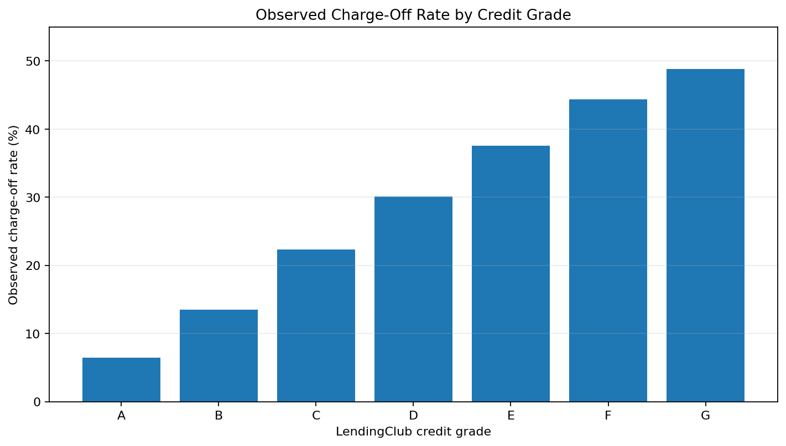
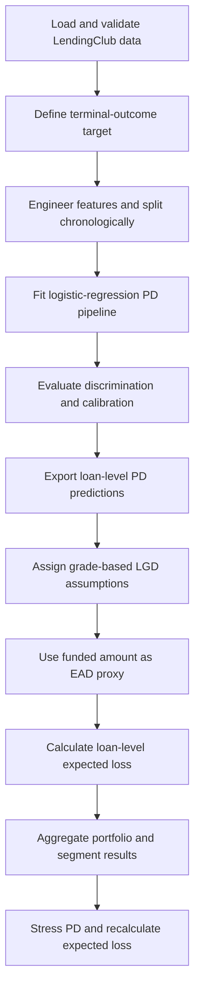
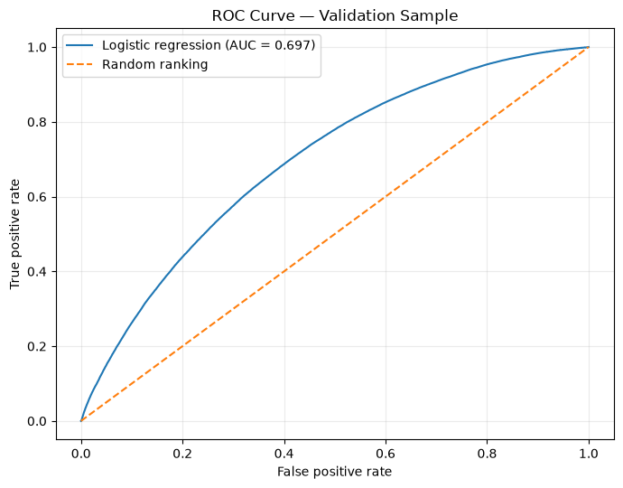
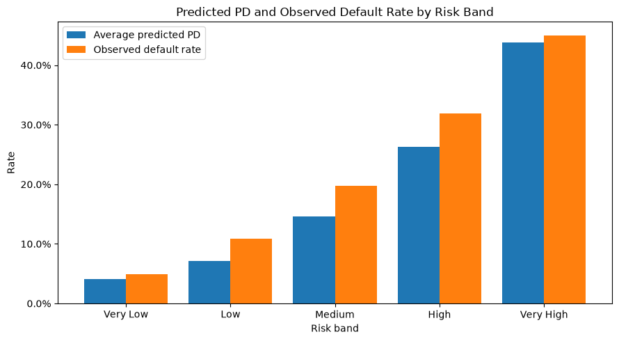
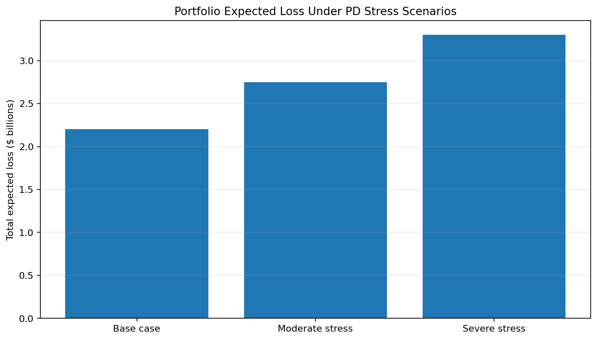

# Project 03 — Credit Risk: PD / LGD / EAD & Expected Loss

**A Python-based consumer-credit risk framework that develops a Probability of Default (PD) model, applies transparent Loss Given Default (LGD) assumptions and an Exposure at Default (EAD) proxy, aggregates expected losses, and tests portfolio sensitivity to stressed default probabilities.**

The project follows a five-notebook workflow using LendingClub loan-performance data: data preparation and exploratory analysis, logistic-regression PD estimation, LGD/EAD construction, expected-loss and portfolio segmentation, and portfolio-level stress testing.

> **Scope:** This is a research and portfolio project for demonstrating credit-risk methodology and model interpretation. LGD and EAD are simplified, assumption-based inputs; the outputs are not validated estimates of realized credit losses or a production/regulatory expected-credit-loss framework.

## Contents

- [At a glance](#at-a-glance)
- [Data and target definition](#data-and-target-definition)
- [Workflow](#workflow)
- [Key results](#key-results)
- [PD model and validation](#pd-model-and-validation)
- [LGD and EAD methodology](#lgd-and-ead-methodology)
- [Expected loss and portfolio segmentation](#expected-loss-and-portfolio-segmentation)
- [Stress testing](#stress-testing)
- [Notebook guide](#notebook-guide)
- [Methodology and implementation details](#methodology-and-implementation-details)
- [Reproducing the analysis](#reproducing-the-analysis)
- [Limitations and future extensions](#limitations-and-future-extensions)

## At a glance

| Item | Implementation |
|---|---|
| Source dataset | LendingClub `Loan_status_2007-2020Q3.gzip` |
| Initial extract | 2,925,493 rows and 15 selected fields |
| Terminal-outcome sample | 1,863,080 loans: Fully Paid or Charged Off |
| Target definition | `Fully Paid` → 0; `Charged Off` → 1; unresolved statuses excluded |
| Temporal development sample | 1,495,018 loans, June 2007–August 2017 |
| Temporal validation sample | 368,062 loans, September 2017–September 2020 |
| PD model | L2-regularized logistic regression, `C=1.0`, ten predictors |
| PD validation metrics | ROC-AUC 0.6969; KS 0.2874; Gini 0.3937 |
| LGD | Assumption-based by credit grade: 40%, 50%, 60%, or 70% |
| EAD | Original funded amount used as an exposure proxy |
| Expected loss | `EL = PD × LGD × EAD`, calculated loan-by-loan and aggregated |
| Portfolio stress tests | Base case, +25% PD moderate stress, +50% PD severe stress |

## Data and target definition

### Dataset and data preparation

The data-preparation notebook reads the LendingClub loan-performance file `Loan_status_2007-2020Q3.gzip` and selects 15 fields covering loan status and origination date, loan size and interest rate, borrower income and debt-to-income ratio, FICO range, employment length, credit grade, home ownership, purpose, loan identifier, and recoveries.

The full selected extract has **2,925,493 rows**. The recorded data-quality checks found zero exact duplicate rows. In the full extract, employment length is the most frequently missing selected field (about 7.01%); after target filtering, it is missing for 6.29% of the terminal-outcome sample. There were 1,085 loans with annual income at or below zero; their loan-to-income ratio is left missing rather than calculated using an invalid denominator.

The terminal-outcome target includes:

- `Fully Paid` and the corresponding legacy terminal-status variant → `default_flag = 0`
- `Charged Off` and its corresponding legacy terminal-status variant → `default_flag = 1`

Active or unresolved statuses—including `Current`, `Late`, `In Grace Period`, `Issued`, and the separate `Default` status—are excluded from this primary modeling sample. This is a deliberate simplification for a binary classification workflow. The resulting sample contains **1,499,771 fully paid loans** and **363,309 charged-off loans**, giving a **19.50% observed charge-off share**. This is not the event rate across all records in the original source file.

### Chronological split

The sample is split by `issue_d`, using a cutoff of **1 August 2017** and keeping all loans in the cutoff month in development. Development includes June 2007–August 2017; validation covers September 2017–September 2020. The observed charge-off rate is 18.77% in development and 22.47% in validation, a 3.70 percentage-point increase. This time difference is important when interpreting out-of-time performance and calibration.

### Exploratory findings

The initial analysis gives several descriptive patterns that motivate, but do not by themselves validate, the PD model:

- Observed charge-off rate increases from **6.45% for Grade A** to **48.78% for Grade G**.
- The rate decreases from **22.49% in the lowest income quartile** to **16.14% in the highest**.
- It increases from **15.13% in the lowest loan-amount quartile** to **23.11% in the highest**.
- Small-business loans have the highest observed charge-off rate by stated purpose (28.71%) in the output; low-count categories should be interpreted cautiously.

<p align="center">
  
</p>

This figure is a supplemental chart recreated from the recorded credit-grade summary in Notebook 01.

## Workflow



## Key results

### PD model performance on the validation sample

| Metric | Validation result | What it measures |
|---|---:|---|
| ROC-AUC | **0.6969** | Ability to rank defaulting loans above non-defaulting loans across thresholds |
| KS statistic | **0.2874** | Maximum separation between the predicted-PD distributions of the two outcome classes |
| Gini coefficient | **0.3937** | Discrimination measure calculated as `2 × AUC − 1` |

The results indicate that the baseline model differentiates risk to some extent, but they do not establish that the predicted PD levels are calibrated or sufficient for credit decisions. Model performance should be considered alongside calibration, the temporal change in observed charge-off rate, and the assumptions used downstream.

### Validation calibration

| Measure | Result |
|---|---:|
| Mean predicted PD | 18.26% |
| Observed validation charge-off rate | 22.47% |
| Calibration gap (observed minus predicted) | **+4.21 percentage points** |

The positive calibration gap means the model underestimates the observed validation event rate on average. Observed charge-off rates also exceed mean predicted PD in each of the five risk bands:

| Risk band | Loans | Mean predicted PD | Observed charge-off rate | Gap |
|---|---:|---:|---:|---:|
| Very Low | 34,965 | 4.07% | 4.89% | +0.82 pp |
| Low | 75,302 | 7.17% | 10.82% | +3.66 pp |
| Medium | 115,694 | 14.59% | 19.77% | +5.18 pp |
| High | 106,582 | 26.26% | 31.87% | +5.62 pp |
| Very High | 35,519 | 43.75% | 45.03% | +1.27 pp |

<p align="center">
  
</p>

<p align="center">
  
</p>

The ROC curve displays discrimination across classification thresholds. The risk-band chart helps assess ranking across risk levels; the separate calibration table quantifies the gap between predicted PD and observed event rates. A consistent underprediction pattern points to a need for further calibration work, fitted on a distinct calibration subset and evaluated on untouched data.

## LGD and EAD methodology

### Loss Given Default (LGD)

The dataset contains aggregate recoveries but does not include a reliable outstanding balance at default. An exploratory calculation on defaulted loans compares total recoveries of approximately **$401.7 million** with total original funded amount of approximately **$4.364 billion**. This gives a recovery-ratio proxy of **9.21%** and an implied LGD proxy of **90.79%**.

That ratio is **not used as a validated realized LGD estimate** because original funded amount is not the same as exposure outstanding at default. The expected-loss workflow instead uses transparent illustrative assumptions by credit grade:

| Credit grade | Risk segment | Assumed LGD |
|---|---|---:|
| A–B | Low | 40% |
| C–D | Medium | 50% |
| E–F | High | 60% |
| G | Very High | 70% |

These are placeholders for demonstrating the EL calculation, not LGD parameters estimated from loan-level realized losses. The assumed increase in LGD across weaker grades requires empirical validation or sensitivity analysis before decision use.

### Exposure at Default (EAD)

The source does not provide outstanding principal at default, so the implementation uses `funded_amnt` as the simplified EAD proxy:

$$
EAD_{i,proxy} = Funded\ Amount_i
$$

The recorded funded-amount proxy has no missing values in either sample, ranges from **$500 to $40,000**, and has a median of **$12,000** (mean **$14,444.72**). It represents original funded exposure and does not adjust for repayments before default.

## Expected loss and portfolio segmentation

### Expected-loss calculation

Expected loss is calculated for each loan using the PD model prediction, credit-grade LGD assumption, and funded-amount EAD proxy:

$$
EL_i = PD_i \times LGD_i \times EAD_{i,proxy}
$$

Portfolio expected loss is the sum of loan-level expected losses. The expected-loss rate is total expected loss divided by total EAD proxy; it is therefore an exposure-weighted portfolio measure, not the simple average of loan-level loss rates.

### Portfolio results

| Metric | Development | Validation |
|---|---:|---:|
| Loan count | 1,495,018 | 368,062 |
| Total EAD proxy | $21.595 billion | $5.557 billion |
| Total expected loss | **$2.201 billion** | **$535.59 million** |
| Expected loss / EAD proxy | **10.192%** | **9.638%** |

The development sample has an estimated expected-loss rate about 0.554 percentage points higher than the validation sample. Treat this as a descriptive comparison, not evidence of better or worse model performance: sample composition, in-sample versus out-of-time PD predictions, and the LGD/EAD simplifications all affect the result.

Notebook 04 independently recomputes `PD × LGD × EAD` and compares the result with the exported values. The maximum absolute difference is approximately `3.638e-12` in each sample, and portfolio aggregation checks pass. These checks establish arithmetic consistency, not predictive validity of the PD model or validity of the LGD/EAD assumptions.

### Where expected loss is concentrated

| Segment view | Finding in development sample |
|---|---|
| Credit grade | Grade C contributes approximately $673.4 million (30.59%) of total EL. Grades C, D, and E together contribute about 71.45%. Grade G has the highest grade-level EL rate (about 34.51%) but contributes 3.03% of total EL. |
| Loan purpose | Debt consolidation contributes approximately $1.443 billion (65.57%); credit card loans contribute 18.38%. Together they account for about 83.95% of EL. Small-business loans have the highest purpose-level EL rate (about 15.74%) but represent a much smaller exposure. |
| PD-based risk band | The high-risk band contributes 85.64% of EL at a 14.30% EL rate; medium risk contributes 13.54% at 4.06%; low risk contributes 0.82% at 1.67%. The bands are defined from predicted-PD thresholds, so these findings describe the modelled distribution of loss rather than independently validating the model. |
| Borrower income | The greater-than-$40K to $80K segment contributes about 48.04% of EL. Among reported-income bands, the $40K-or-below segment has the highest EL rate (11.43%), while the greater-than-$120K segment has the lowest (8.21%). |

The segment results distinguish **loss intensity** (EL relative to exposure) from **absolute contribution** (dollars or share of total EL). A segment can have the highest loss rate without being the largest contributor if it has a comparatively small exposure.

## Stress testing

The stress test increases each loan's predicted PD while leaving LGD assumptions and EAD proxy unchanged. Stressed PD values are capped at 100%.

| Scenario | PD multiplier | EAD proxy | Weighted-average PD | Total expected loss | Incremental EL vs. base | EL / EAD |
|---|---:|---:|---:|---:|---:|---:|
| Base case | 1.00× | $21.595bn | 20.21% | $2.201bn | — | 10.19% |
| Moderate stress | 1.25× | $21.595bn | 25.26% | $2.751bn | $550.01m | 12.74% |
| Severe stress | 1.50× | $21.595bn | 30.31% | $3.301bn | $1.100bn | 15.28% |

<p align="center">
  
</p>

Under moderate stress, the expected loss increases by approximately **$550 million**. Under severe stress, it increases by approximately **$1.10 billion** relative to the base case. These results are deterministic sensitivity estimates, not forecasts of realized losses or a fully specified macroeconomic downturn scenario.

## Notebook guide

Run the notebooks in numerical order. The later notebooks consume CSV outputs written by earlier steps under `data/processed/`.

| Notebook | Purpose and main outputs |
|---|---|
| `01_data_preparation.ipynb` | Load the LendingClub source data; inspect data quality and terminal statuses; define `default_flag`; perform descriptive risk analysis and feature engineering; split chronologically; write development and validation datasets. |
| `02_probability_of_default_model.ipynb` | Fit the logistic-regression PD pipeline; create predictions; inspect coefficients and odds ratios; evaluate risk bands, ROC-AUC, KS, Gini and calibration; export PD predictions. |
| `03_lgd_ead_estimation.ipynb` | Review recovery information; define assumption-based LGD by grade and an EAD proxy from `funded_amnt`; calculate and export loan-level expected loss inputs and results. |
| `04_expected_loss.ipynb` | Reconcile loan-level expected loss; calculate portfolio summaries; rank largest individual EL contributors; segment EL by credit grade, purpose, PD risk band and income; run reconciliation checks. |
| `05_portfolio_credit_risk_stress_testing.ipynb` | Summarize the development portfolio risk profile; compare base, moderate and severe PD stress scenarios; calculate incremental expected loss. |

## Methodology and implementation details

### Logistic regression for PD

The baseline PD model defines the linear predictor as:

$$
z_i = \beta_0 + \sum_{j=1}^{p} \beta_j X_{ij}
$$

and transforms it to a probability using the logistic function:

$$
PD_i = \frac{1}{1 + e^{-z_i}}
$$

The implementation uses an L2-regularized scikit-learn logistic regression with `C=1.0`. Numerical predictors are imputed using the development-sample median and standardized; categorical predictors are imputed using the development-sample most frequent category and one-hot encoded. The preprocessing is included in the pipeline so that validation data does not determine imputation, scaling, or category encoding. The model uses ten predictors: `loan_amnt`, `int_rate`, `annual_inc`, `dti`, `fico_avg`, `loan_to_income`, `grade`, `emp_length`, `home_ownership`, and `purpose`.

Post-outcome fields such as `recoveries` and `loan_status` are excluded from predictors to avoid target leakage. `issue_d` is used for the chronological split rather than as a direct predictor. The baseline uses no hyperparameter tuning.

### PD validation measures

The model is assessed with ROC-AUC, KS and Gini for discrimination, and mean predicted PD versus observed event frequency for calibration. These are distinct dimensions: good ranking performance does not guarantee calibrated probabilities. The current positive calibration gaps indicate underprediction on the validation sample, and any recalibration should be fitted on a distinct calibration subset before being evaluated on an untouched sample.

### Expected loss aggregation

For loan $i$, the model computes:

$$
EL_i = PD_i \times LGD_i \times EAD_i
$$

Total portfolio expected loss is $\sum_i EL_i$, and the expected-loss rate is:

$$
EL\ Rate = \frac{\sum_i EL_i}{\sum_i EAD_i}
$$

This rate is EAD-weighted. The separately reported arithmetic-average PD and LGD are descriptive metrics and should not be multiplied together to reproduce the total portfolio EL rate.

## Reproducing the analysis

### 1. Confirm the repository layout

This project is one of four projects in the `quantitative-risk-model-validation` repository. The shared `requirements.txt` is in the repository root, one level above `project_03_credit_risk/`. The source dataset is expected at `project_03_credit_risk/data/raw/Loan_status_2007-2020Q3.gzip`; it is not included in this README bundle.

Expected structure:

```text
quantitative-risk-model-validation/
├── requirements.txt
├── project_03_credit_risk/
│   ├── data/
│   │   ├── raw/
│   │   │   └── Loan_status_2007-2020Q3.gzip  # obtain separately
│   │   └── processed/                        # generated by notebooks
│   ├── notebooks/
│   │   ├── 01_data_preparation.ipynb
│   │   ├── 02_probability_of_default_model.ipynb
│   │   ├── 03_lgd_ead_estimation.ipynb
│   │   ├── 04_expected_loss.ipynb
│   │   └── 05_portfolio_credit_risk_stress_testing.ipynb
│   ├── results/
│   │   └── figures/
│   └── README.md
└── .venv/  # shared environment, if used in your checkout
```

The notebook paths assume the project layout above. If the source data or notebook directories are moved, update the relative paths accordingly.

### 2. Install dependencies

From the repository root, activate the existing shared environment and install the shared dependencies:

```bash
# Windows PowerShell
.\.venv\Scripts\Activate.ps1

# macOS / Linux
source .venv/bin/activate

python -m pip install --upgrade pip
python -m pip install -r requirements.txt
```

The shared dependency file is the source of truth; this README intentionally does not maintain a second project-specific dependency list.

### 3. Run the notebooks

The notebook code uses paths such as `../data/raw` and `../data/processed`. To preserve those relative paths, launch Jupyter from the `notebooks` directory:

```bash
cd project_03_credit_risk/notebooks
jupyter lab
```

Run notebooks 01 through 05 in sequence. Notebook 01 creates the processed development and validation files; Notebook 02 writes the PD predictions; Notebook 03 writes loan-level expected-loss datasets; Notebook 04 consumes them for portfolio analysis; Notebook 05 uses the development expected-loss output for stress testing. A fresh run of Notebook 01 requires the LendingClub source file in the expected `data/raw/` location.

### 4. Review generated outputs

The notebook workflow writes CSV files beneath `data/processed/`. The figures linked in this README are stored in `results/figures/`; the ROC and PD risk-band charts are extracted from the saved Notebook 02 outputs, while the other figures in this README are supplemental charts recreated from numeric results recorded in the notebooks.

## Limitations and future extensions

- **PD calibration:** The validation mean predicted PD (18.26%) is below the observed charge-off rate (22.47%). All five validation risk bands also show observed rates above mean predicted PD. Calibration requires further work and out-of-sample evaluation.
- **Discrimination:** ROC-AUC is 0.6969. This is a baseline result, not evidence that the model is fit for live underwriting or portfolio decision-making. Hyperparameter tuning and alternative benchmark models are not included.
- **Temporal drift:** Validation spans a later origination period and has a higher observed charge-off rate than development. Changes in borrower mix, underwriting, product, or economic conditions may affect performance.
- **Feature sensitivity:** The raw loan-to-income ratio has a median near 0.198 but an extreme recorded maximum of 40,000. Its outlier treatment and suitability should be investigated using development data only; it is not arbitrarily capped in this workflow.
- **LGD assumptions:** LGD is assigned by credit grade rather than estimated from loan-level realized losses. The exploratory 90.79% LGD proxy uses original funded amounts as the denominator and is not treated as a validated loss-severity estimate.
- **EAD proxy:** Original funded amount is used rather than the balance outstanding at default, so principal repayments and balance changes are not reflected.
- **Expected-loss interpretation:** EL results inherit the uncertainty of the PD model and the LGD/EAD assumptions. The results are illustrative, not regulatory/accounting ECL estimates or forecasts of realized losses.
- **Stress design:** The stress scenarios mechanically increase PD by 25% or 50%, capped at 100%, while holding LGD and EAD constant. They do not represent a calibrated macroeconomic scenario.
- **Data horizon and representativeness:** The selected LendingClub sample ends in September 2020, so it does not establish performance under later lending conditions.

Potential extensions include out-of-time model benchmarking, calibration on a separate sample, Brier score and calibration plots, probability transformations or winsorization of heavy-tailed features where justified, empirically estimated LGD from outstanding exposure and realized recoveries, amortization-aware EAD, sensitivity analysis for LGD, and richer macroeconomic stress scenarios.

---

**Project takeaway:** This project demonstrates an end-to-end credit-risk calculation chain from origination data to PD, LGD and EAD inputs, portfolio expected loss, segmentation and PD stress testing. Its most important model-risk finding is that the baseline PD model underestimates the observed validation charge-off rate, while the LGD and EAD components remain illustrative assumptions that require stronger data before the estimated expected losses can be used operationally.
