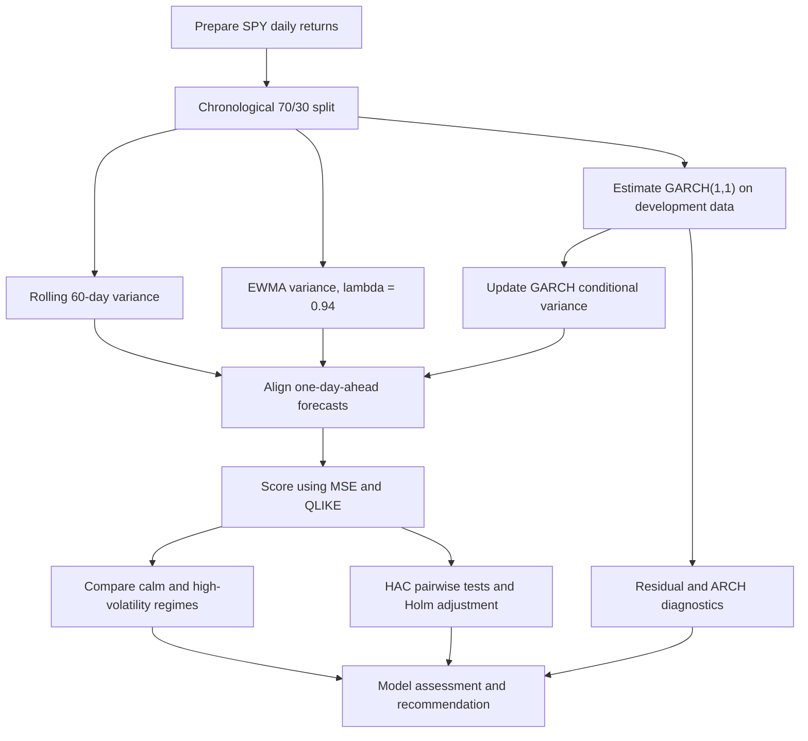
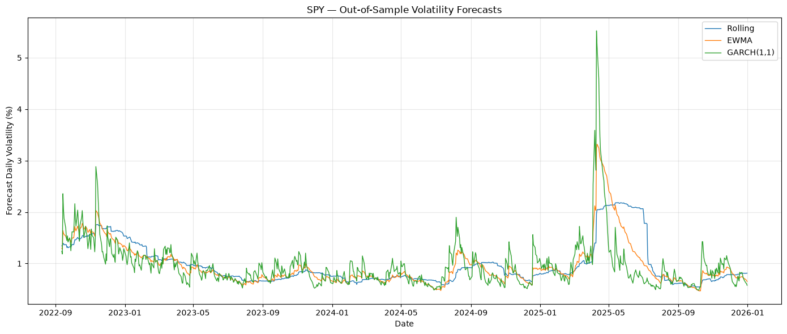
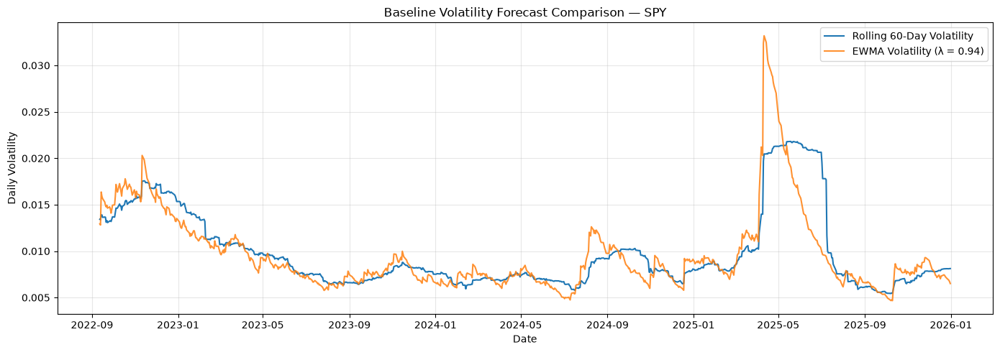
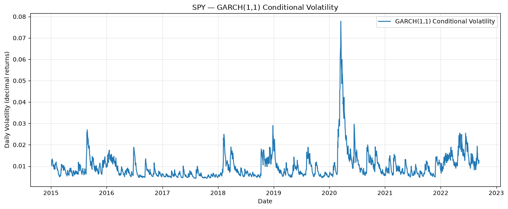
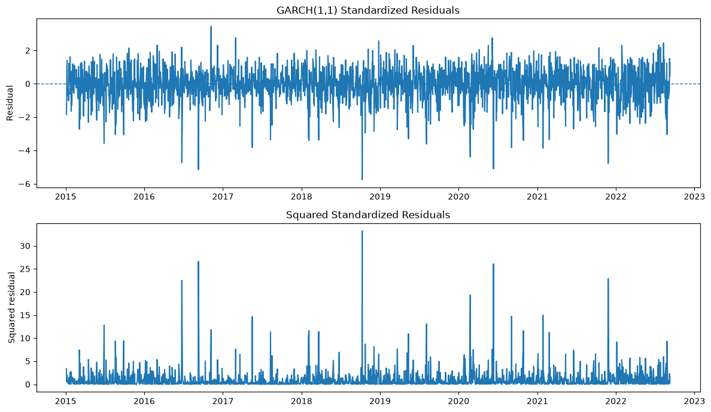
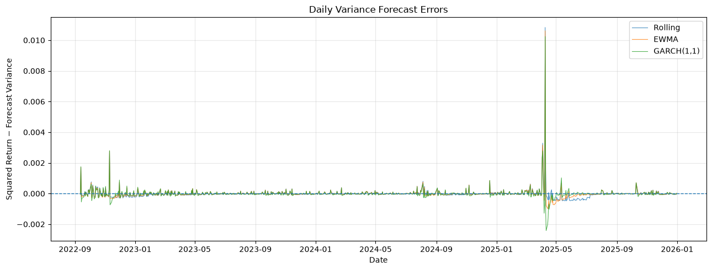
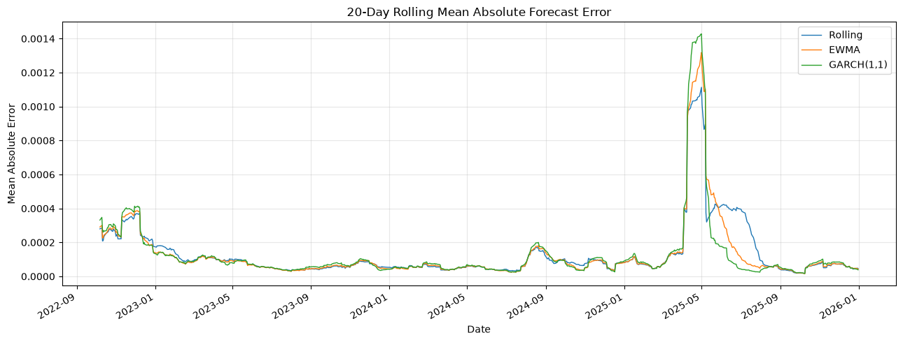

# Project 04 — Volatility Model Validation & Challenger Analysis

**A Python-based volatility forecasting and model-validation framework comparing rolling volatility, Exponentially Weighted Moving Average (EWMA), and GARCH(1,1) forecasts for SPY.**

The project evaluates one-day-ahead volatility forecasts using a chronological out-of-sample test, complementary loss functions, volatility-regime analysis, residual diagnostics, and statistical comparison of forecast losses. The goal is not simply to identify the lowest score, but to determine whether the observed differences support a defensible model preference.

> **Scope:** This is a research and portfolio project focused on quantitative model assessment. It is not a production risk platform or investment recommendation.

## Contents

- [At a glance](#at-a-glance)
- [Data and forecasting design](#data-and-forecasting-design)
- [Workflow](#workflow)
- [Key results](#key-results)
- [Forecast behavior and diagnostics](#forecast-behavior-and-diagnostics)
- [Performance across volatility regimes](#performance-across-volatility-regimes)
- [Statistical comparison and recommendation](#statistical-comparison-and-recommendation)
- [Notebook guide](#notebook-guide)
- [Methodology and implementation details](#methodology-and-implementation-details)
- [Limitations and future extensions](#limitations-and-future-extensions)

## At a glance

| Item | Implementation |
|---|---|
| Market series | SPY, an ETF tracking the S&P 500 |
| Return sample | 2,765 daily returns, from 2015-01-05 to 2025-12-31 |
| Development sample | 1,935 observations, 2015-01-05 to 2022-09-09 |
| Out-of-sample test | 830 observations, 2022-09-12 to 2025-12-31 |
| Forecast horizon | One trading day ahead |
| Benchmark 1 | Rolling variance using the previous 60 daily returns |
| Benchmark 2 | EWMA variance with decay factor $\lambda = 0.94$ |
| Challenger | GARCH(1,1), estimated by maximum likelihood with normal innovations |
| Forecast target | Squared daily return, $r_t^2$, as a proxy for unobserved daily variance |
| Forecast metrics | Mean Squared Error (MSE) and Quasi-Likelihood (QLIKE) loss |
| Comparative inference | HAC-based Diebold–Mariano-style asymptotic tests with Holm adjustment |
| GARCH diagnostics | Convergence and parameter constraints, Ljung–Box tests, and ARCH LM test |

## Data and forecasting design

The notebooks use the market-data utility developed in Project 01 and focus on SPY daily returns. The downloaded return sample contains **2,765 observations** from January 2015 through December 2025. The recorded data checks found no missing returns or duplicate dates.

The sample is divided chronologically, with the earliest 70% used as the development sample and the latest 30% reserved for out-of-sample evaluation.

| Sample | Observations | Period | Purpose |
|---|---:|---|---|
| Development | 1,935 | 2015-01-05 to 2022-09-09 | Estimate GARCH parameters and establish the model forecasts |
| Out-of-sample test | 830 | 2022-09-12 to 2025-12-31 | Compare rolling, EWMA, and GARCH forecasts on common dates |

All forecasts are aligned to the same 830 test dates and use one-day-ahead timing. A forecast for date $t$ uses information available through $t-1$. GARCH parameters are estimated on the development sample and are not refitted during the test period; conditional variance is updated as prior returns become observable. The forecast-alignment checks report no missing or non-positive variance forecasts and no duplicate dates.

## Workflow

## Key results

Both scoring metrics use the same out-of-sample dates. MSE is calculated between squared daily returns and forecast variance. For both MSE and QLIKE, **lower values indicate better performance under the implemented loss definitions**.

### Overall out-of-sample forecast accuracy

| Model | MSE | QLIKE |
|---|---:|---:|
| **EWMA** | **$1.952888 \times 10^{-7}$** | -8.347274 |
| **GARCH(1,1)** | $1.965273 \times 10^{-7}$ | **-8.376274** |
| Rolling 60-day | $2.029576 \times 10^{-7}$ | -8.257238 |

**Interpretation:** EWMA records the lowest overall MSE, narrowly ahead of GARCH(1,1). GARCH(1,1) records the lowest QLIKE. Rolling volatility has the highest loss under both metrics. The preferred model therefore depends on the loss function; the ranking by itself does not establish statistical superiority.

  

The plotted forecasts show the differences in responsiveness across models. Rolling volatility is comparatively smooth because it uses a fixed window. EWMA places exponentially declining weights on older returns. GARCH responds recursively to recent shocks and its previous conditional variance, producing sharper forecast changes around some market events.

## Forecast behavior and diagnostics

### Baseline behavior: rolling volatility and EWMA

  

The 60-day benchmark gives equal weight to observations in the latest window. Its forecasts may react slowly when a shock occurs and remain elevated while that shock stays inside the window. EWMA responds through exponential weighting, so recent squared returns have a larger effect on the forecast.

### GARCH challenger and residual diagnostics

The GARCH(1,1) model is estimated by maximum likelihood using the 1,935 development-period observations. Returns are scaled to percentage units for estimation, and variance forecasts are converted back to decimal-return variance units for comparison.

The key estimated parameters are:

| Parameter | Estimate | Interpretation |
|---|---:|---|
| Constant mean, $\mu$ | 0.0912 | Mean return in percentage-return units |
| Variance intercept, $\omega$ | 0.0418 | Variance intercept in percentage-return-squared units |
| ARCH coefficient, $\alpha_1$ | 0.2266 | Sensitivity to the previous squared innovation |
| GARCH coefficient, $\beta_1$ | 0.7473 | Persistence from the previous conditional variance |
| Persistence, $\alpha_1 + \beta_1$ | **0.9739** | High persistence, below one |

The optimizer reports successful convergence. The variance parameters meet the notebook's non-negativity constraints, and the estimated persistence is below one. A value close to one indicates that volatility shocks decay slowly under this specification.

  

Standardized residual diagnostics were also conducted on the fitted development-period model. At the 5% significance level, the tests do not detect significant residual autocorrelation or remaining ARCH effects at the examined lags.

| Diagnostic | Lag(s) | p-value(s) | Interpretation at 5% level |
|---|---|---:|---|
| Ljung–Box, standardized residuals | 10, 20 | 0.7129; 0.6886 | No significant autocorrelation detected |
| Ljung–Box, squared standardized residuals | 10, 20 | 0.4268; 0.7879 | No significant autocorrelation detected in squared residuals |
| ARCH LM test | 10 lags | 0.4422 | No significant remaining ARCH effect detected |

  

These diagnostics support using GARCH(1,1) as a challenger in the out-of-sample comparison, but they do not prove that the specification is correct or that its forecasts outperform the alternatives. The model's normal-innovation assumption remains a limitation for heavy-tailed financial returns.

### Forecast errors and the April 2025 episode

  

The evaluation period contains large SPY moves in early April 2025, including a return of approximately **-5.85% on April 4** and **+10.50% on April 9**. The forecasts respond differently to this episode:

| Forecast date | Rolling volatility | EWMA volatility | GARCH(1,1) volatility |
|---|---:|---:|---:|
| 2025-04-10 | 1.97% | 3.24% | **5.52%** |

The April 10 forecasts incorporate the April 9 return, consistent with one-day-ahead timing. GARCH produces the sharpest response in this episode, EWMA responds more smoothly, and rolling volatility changes more gradually.

  

The 20-session rolling mean absolute error smooths the daily forecast errors and makes changes in error magnitude easier to compare over time. The large April 2025 episode has a visible effect on all three models. Since squared daily returns are a noisy proxy for daily variance, these error plots should be interpreted as comparative diagnostics rather than direct observations of latent volatility.

## Performance across volatility regimes

To examine whether rankings vary with market conditions, the notebook labels observations using a trailing 20-session return-volatility estimate shifted by one session. The bottom quartile represents calmer conditions and the top quartile represents higher-volatility conditions. The middle half is excluded from this comparison. Each reported regime contains 207 observations.

| Regime | Model | Observations | MSE | QLIKE |
|---|---|---:|---:|---:|
| Calm | Rolling | 207 | $1.393868 \times 10^{-8}$ | -8.862293 |
| Calm | EWMA | 207 | $9.516805 \times 10^{-9}$ | -8.856879 |
| Calm | **GARCH(1,1)** | 207 | **$9.285078 \times 10^{-9}$** | **-8.913380** |
| High volatility | Rolling | 207 | $7.558782 \times 10^{-7}$ | -7.145862 |
| High volatility | **EWMA** | 207 | **$7.387571 \times 10^{-7}$** | -7.410968 |
| High volatility | GARCH(1,1) | 207 | $7.416553 \times 10^{-7}$ | **-7.469236** |

**Regime findings:**

- In calm conditions, GARCH(1,1) records the lowest MSE and QLIKE.
- In high-volatility conditions, EWMA records the lowest MSE, while GARCH(1,1) records the lowest QLIKE.
- Rolling volatility performs least favorably during high-volatility conditions under both metrics.
- These results are descriptive. Since the middle half of observations is omitted and the regime comparisons do not establish statistical significance, they should not be treated as conclusive evidence of a winning model.

## Statistical comparison and recommendation

Pairwise forecast-loss differences are assessed with a HAC-based Diebold–Mariano-style asymptotic test. The primary comparison uses a Newey–West HAC estimate with five lags. Pairwise p-values are adjusted using Holm's method separately for MSE and QLIKE.

| Metric | Model comparison | Raw p-value | Holm-adjusted p-value |
|---|---|---:|---:|
| MSE | Rolling vs EWMA | 0.2973 | 0.8920 |
| MSE | Rolling vs GARCH(1,1) | 0.6697 | 1.0000 |
| MSE | EWMA vs GARCH(1,1) | 0.9059 | 1.0000 |
| QLIKE | Rolling vs EWMA | 0.0755 | 0.2266 |
| QLIKE | Rolling vs GARCH(1,1) | 0.0857 | 0.2266 |
| QLIKE | EWMA vs GARCH(1,1) | 0.2928 | 0.2928 |

None of the pairwise differences is statistically significant at the 5% level after Holm adjustment. Sensitivity checks with HAC lag choices of 5, 10, and 20 also leave all unadjusted pairwise p-values above 0.05. The relatively small observed differences in average loss are not sufficient to establish that any model is statistically superior.

### Model assessment

| Model | Strengths | Weaknesses / considerations |
|---|---|---|
| Rolling 60-day | Simple, transparent benchmark | Equal weighting creates slower response to new shocks; older shocks remain in the window |
| EWMA | Efficient, responsive, no separate parameter-estimation step in this comparison | Results depend on the decay factor; does not explicitly estimate a long-run variance level |
| GARCH(1,1) | Explicitly models conditional variance persistence; lowest overall QLIKE | Requires estimation, relies on specification assumptions, and its QLIKE advantage is not statistically significant in pairwise tests |

**Recommendation: retain EWMA as the primary benchmark and GARCH(1,1) as a challenger.** EWMA achieved the lowest overall MSE and is computationally simple. GARCH achieved the lowest overall QLIKE and performed well in regime-based analysis, so it remains a useful challenger. The evidence does not justify replacing EWMA with GARCH solely on the basis of this test period. Rolling volatility remains a useful transparent reference despite having the highest overall loss on both metrics.

## Notebook guide

The three notebooks form a sequential workflow: design the experiment, estimate and diagnose the GARCH challenger, then evaluate all models out of sample.

| Notebook | Purpose and main outputs |
|---|---|
| `01_forecast_design.ipynb` | Prepares SPY returns, defines the chronological development/test split, generates rolling 60-day and EWMA forecasts, checks alignment, and summarizes baseline forecast behavior. |
| `02_garch_challenger.ipynb` | Estimates the GARCH(1,1) challenger, generates aligned one-day-ahead forecasts, examines the April 2025 episode, tests standardized residuals for autocorrelation and remaining ARCH effects, and checks parameter validity. |
| `03_out_of_sample_validation.ipynb` | Scores the models using MSE and QLIKE, compares calm and high-volatility regimes, runs HAC-based pairwise tests with Holm adjustment, checks HAC-lag sensitivity, and presents the final model recommendation. |

## Methodology and implementation details

### Rolling variance

The rolling benchmark estimates variance from the previous 60 daily returns, with equal weight given to each observation:

$$
\hat{\sigma}^{2}_{t\mid t-1} = \operatorname{Var}(r_{t-60}, \ldots, r_{t-1})
$$

The window is shifted so that the return on forecast date $t$ is not used to generate that date's forecast.

### EWMA variance

EWMA gives greater weight to recent squared returns through exponentially declining weights. The recurrence used for one-day-ahead forecasting is:

$$
\hat{\sigma}^{2}_{t\mid t-1} = \lambda\hat{\sigma}^{2}_{t-1\mid t-2} + (1-\lambda)r_{t-1}^{2}, \qquad \lambda = 0.94
$$

The decay factor is held fixed for this experiment rather than tuned on the test period.

### GARCH(1,1)

The GARCH specification models returns and conditional variance as:

$$
r_t = \mu + \epsilon_t, \qquad \epsilon_t = \sigma_t z_t
$$

$$
\sigma_t^2 = \omega + \alpha_1\epsilon_{t-1}^2 + \beta_1\sigma_{t-1}^2
$$

The baseline assumes conditionally normal innovations. Parameters are estimated by maximum likelihood on the development sample. The estimated persistence is $\alpha_1 + \beta_1 = 0.9739$, below one but close to it.

### Forecast scoring

Squared daily returns are used as a proxy for daily variance. For forecast variance $\hat{\sigma}_t^2$:

$$
\mathrm{MSE} = \frac{1}{T}\sum_{t=1}^{T}\left(r_t^2-\hat{\sigma}_t^2\right)^2
$$

$$
\mathrm{QLIKE} = \frac{1}{T}\sum_{t=1}^{T}\left[\log(\hat{\sigma}_t^2)+\frac{r_t^2}{\hat{\sigma}_t^2}\right]
$$

MSE heavily penalizes large errors, so extreme market moves can dominate the score. QLIKE offers a complementary loss function, and its model ranking can differ from MSE. A lower average loss alone does not establish a statistically significant performance difference.

### Statistical comparison

The notebook compares pairwise loss series with a HAC-based asymptotic test using a Newey–West long-run variance estimate. Five lags are used for the primary comparison, and Holm adjustment is applied within each loss metric. Tests are repeated with 5, 10, and 20 HAC lags as a sensitivity check. Because the implementation uses an asymptotic normal approximation and volatility loss series can be influenced by extreme observations, the results are interpreted cautiously.

## Limitations and future extensions

- **Variance proxy:** A single squared daily return is a noisy proxy for latent daily variance; intraday realized-volatility measures could provide a richer target.
- **Single market series:** Results are specific to SPY and may not generalize to other asset classes or market indices.
- **Evaluation period:** The results depend on the 2022–2025 test period and the extreme observations it contains.
- **Distributional assumptions:** The GARCH challenger assumes conditionally normal innovations and may not fully capture heavy tails. Student-t innovations or alternative GARCH specifications could be examined.
- **Fixed model settings:** The EWMA decay factor and rolling window are fixed; alternative settings may change relative performance.
- **Regime analysis:** Only the lower and upper quartiles of trailing volatility are compared. The middle half of the observations is excluded, and these descriptive comparisons do not establish statistical superiority.
- **Statistical power and inference:** Pairwise loss differences are not statistically significant after adjustment. This does not prove equivalence; results depend on the sample, loss function, and HAC specification.
- **Diagnostic scope:** Residual diagnostics are in-sample checks for the fitted GARCH model; they do not validate every aspect of the out-of-sample forecast process.

Possible extensions include alternative innovation distributions, additional GARCH specifications, volatility forecasts for more asset series, realized-volatility targets, and expanded sensitivity analysis across windows, horizons, and test periods.

---

**Project takeaway:** EWMA has the lowest overall MSE, while GARCH(1,1) has the lowest overall QLIKE and performs well in calm and high-volatility regime comparisons. However, pairwise forecast-loss differences are not statistically significant after Holm adjustment. The evidence supports keeping EWMA as the practical benchmark and GARCH(1,1) as a challenger, rather than declaring a definitive model winner.
